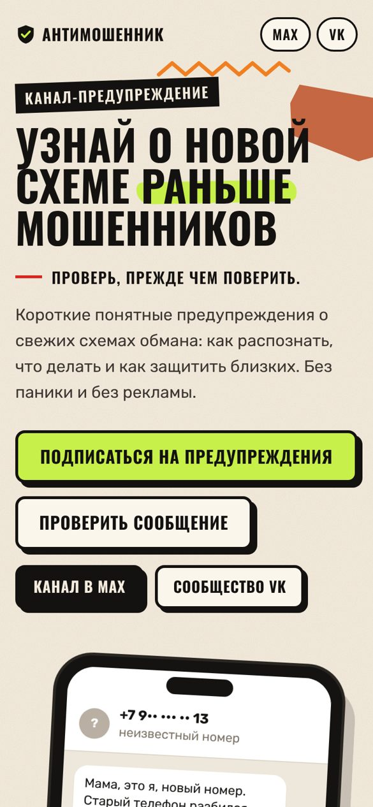

  

<h1 align="center">Антимошенник</h1>

  Короткие понятные предупреждения о свежих схемах мошенников: как распознать, что делать и как защитить близких. 
  Без паники и без рекламы.

  <a href="https://glanass1204-web.github.io/antimoshennik/"><b>Открыть сайт</b></a> ·
  <a href="https://max.ru/channel_antimoshennik">Канал в MAX</a> ·
  <a href="https://vk.ru/shchit_ot_moshennikov">Сообщество VK</a>

## Как это работает

1. **Подписываетесь** на канал в MAX или сообщество VK.
2. **Получаете предупреждение**, когда появляется новая схема обмана.
3. **Знаете, что делать**: в каждом сообщении есть признаки схемы и простые шаги, как себя защитить.

## Что есть на сайте

- **«Развод или нет?»**: короткий тест на реальных примерах сообщений.
- **Свежие схемы**: фейковые сайты шиномонтажа, «работа за взнос», дипфейк-звонок от «родственника» и другие.
- **Если уже попались**: что делать в первые минуты.

Мы не продаём курсы, не просим денег и никогда не пишем первыми.

## Проверить подозрительное сообщение

Если сообщение уже пришло, вставьте его в [Щит от мошенников](https://github.com/glanass1204-web/shchit-ot-moshennikov): он найдёт признаки обмана и покажет уровень риска от 0 до 100.

## Лицензия

[MIT](LICENSE)
